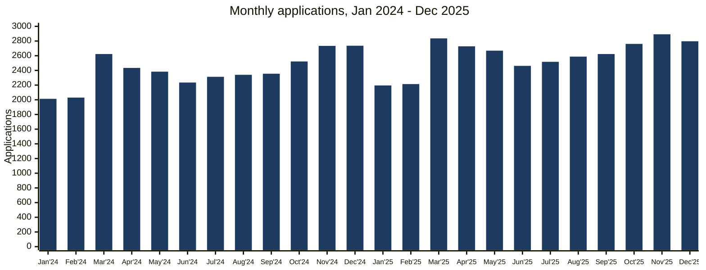
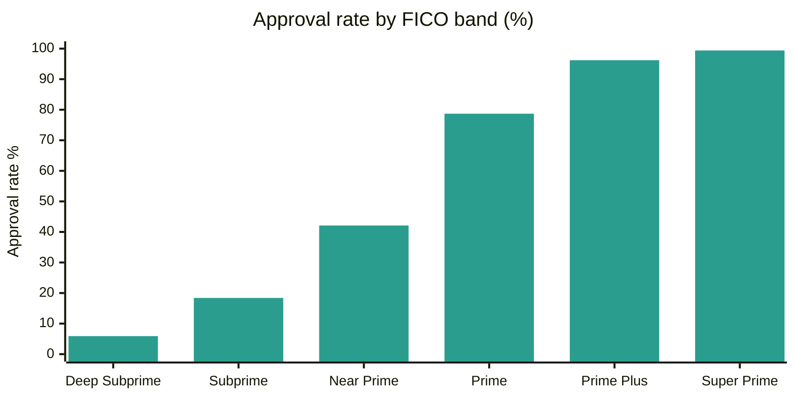
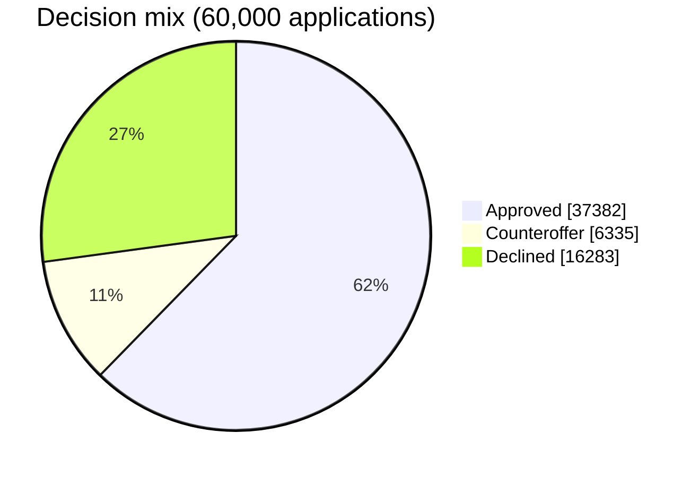
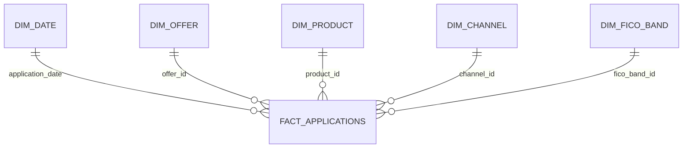

# NBank Credit Card Application Trends Dashboard

**Power BI · SQL · DAX · Python · Data Modeling · Banking Analytics**

A business intelligence case study for **NBank, a fictional bank**: a six-page dashboard that shows
how credit card applications flow from submission to approval to an open account, and what drives
performance across offers, credit tiers and channels.

> All data is fictional and randomly generated by [`data/generate_data.py`](data/generate_data.py).
> No real company, customer or system data is used.

| Total Applications | Approval Rate | Booking Rate | Booked Accounts | Avg Booked Limit |
|:---:|:---:|:---:|:---:|:---:|
| **60,000** | **72.9%** | **77.0%** | **33,671** | **$7,799** |

*Period: January 2024 – December 2025.*

---

## Contents

- [Business problem](#business-problem)
- [Dashboard walkthrough](#dashboard-walkthrough)
- [Key insights (Executive Summary)](#6-executive-summary)
- [Recommendations](#recommendations)
- [KPI definitions](#kpi-definitions)
- [Data model](#data-model)
- [Sample data](#sample-data)
- [SQL examples](#sql-examples)
- [Repository structure](#repository-structure)
- [How to run](#how-to-run)

---

## Business problem

NBank's card marketing, credit and product teams each looked at applications differently, in
separate spreadsheets. Leadership needed **one dashboard** to answer:

1. Is application demand growing, and how much of the change is just seasonality?
2. Which marketing offers bring in applicants who get approved **and** open the card?
3. How does credit quality (FICO tier) shape approval and booking?
4. Where do applicants drop out between submission and an open account?
5. Where should the next marketing dollar and process fix go?

---

## Dashboard walkthrough

The report is designed to be read like a business user would use it: start with the headline,
then drill into the drivers. Full visual specs are in
[`powerbi/report_layout.md`](powerbi/report_layout.md).

> Charts in this README are drawn from the same sample data so the story can be read on GitHub.
> Power BI screenshots for each page will be added to [`screenshots/`](screenshots).

### 1. Landing Page — the headline

**What it measures:** total demand (applications), the share approved (approval rate), and the
share of approved customers who actually open the card (booking rate).

**Why it matters:** applications show marketing reach; approval rate shows how much of that demand
fits the bank's credit appetite; booking rate shows whether approvals turn into revenue-generating
accounts. A card issuer needs all three moving in the right direction.



**Trend summary:** applications grew **8.9%** in 2025 (31,282 vs 28,718) while the approval rate
held steady at about 73% and the booking rate at about 77%. Growth came from more demand, not looser credit.

### 2. Application Trends — growth vs. seasonality

| Pattern | What the data shows | Business meaning |
|---|---|---|
| **January low** | Lowest month both years (avg 2,104) | Post-holiday spending pause; cheapest time to test new campaigns |
| **March spike** | +29% (2024) and +28% (2025) vs February | Tax-refund season lifts credit demand |
| **Q4 peak** | November–December highest (avg 2,790) | Holiday spending drives new card applications |
| **Growth slowing** | YoY growth 8–12% from Jan–Oct 2025, then 5.8% in Nov and 2.2% in Dec | Early warning: demand momentum is fading heading into 2026 |
| **Mobile shift** | Mobile share 30.3% → 37.4%; Branch 15.8% → 12.9% | Digital experience is now the main growth channel |

### 3. Offer Performance — which offers work

| Offer type | Share of apps | Avg FICO | Approval rate | Counteroffer share | Booking rate |
|---|---:|---:|---:|---:|---:|
| Pre-Select | 24.2% | 721 | **85.2%** | 12.6% | 78.3% |
| Partner Promo | 12.8% | 700 | 72.3% | 15.0% | **82.8%** |
| ITA (Invitation to Apply) | 18.2% | 690 | 69.9% | 15.6% | 74.8% |
| Direct (no offer) | 44.7% | 690 | 67.6% | 15.2% | 75.3% |

- **Pre-Select** applicants are pre-screened, so they score higher and get approved most often.
- **Partner Promo** applicants book at the highest rate: they come in with a reason to use the card.
- **ITA** performs almost the same as Direct, so its targeting adds little over organic demand.
- **Counteroffers** (approved at a lower limit than requested) make up 13–16% of approvals in
  every offer type. Counteroffer is a decision outcome, not an offer, so it is tracked inside each offer.

### 4. FICO Analysis — credit quality drives everything



| FICO band | Score range | Share of apps | Approval rate | Booking rate |
|---|---|---:|---:|---:|
| Deep Subprime | 300-579 | 3.0% | 5.9% | 80.4%* |
| Subprime | 580-619 | 7.6% | 18.4% | 77.5% |
| Near Prime | 620-659 | 16.2% | 42.1% | 74.0% |
| Prime | 660-719 | 35.9% | 78.7% | 74.9% |
| Prime Plus | 720-779 | 27.0% | 96.2% | 78.7% |
| Super Prime | 780-850 | 10.3% | 99.4% | 80.5% |

\* Small base: only 107 approvals in this band.

- Approval rate rises steeply with score: from 42% in Near Prime to 79% in Prime.
- **Prime and above supply 88.5% of all approvals**, while 26.8% of applicants are Near Prime or lower.
- The **Prime band** is the largest single segment (36% of applications) and the biggest lever for
  approval volume.
- Secured cards approve far more Near Prime applicants (62% vs ~41% for other products), giving a
  path for lower-score customers.

### 5. Approval & Booking Analysis — where applicants drop out



**Conversion funnel**

| Stage | Applications | Conversion |
|---|---:|---:|
| Submitted | 60,000 | 100% |
| Approved (incl. counteroffer) | 43,717 | 72.9% of submitted |
| Booked (account opened) | 33,671 | 77.0% of approved · 56.1% of submitted |

| Insight | Detail |
|---|---|
| Counteroffers convert poorly | Booking rate **53.2%** vs **81.1%** for straight approvals (avg limit $4,669 vs $8,117) |
| Top decline reasons | High debt-to-income (28.9%), credit score below threshold (19.0%), recent delinquency (14.6%) |
| Phone channel lags | Booking rate ~71% on Phone vs 76–78% on Online, Mobile and Branch |

### 6. Executive Summary

**Key findings**

1. Demand is healthy: **+8.9%** applications year over year with stable approval (~73%) and
   booking (~77%) rates.
2. **Pre-Select** is the most efficient acquisition offer (85% approval); **Partner Promo** produces
   the most engaged customers (82.8% booking).
3. Credit quality is the main driver of approval: Prime and above supply 88.5% of approvals.
4. The biggest leak after approval is the **counteroffer**: almost half of counteroffered customers never open the account.

**Business observations**

- Seasonality is strong and predictable (January low, March and Q4 peaks); YoY views remove it.
- Mobile is replacing Branch as the growth channel.
- Year-over-year growth slowed sharply in November–December 2025.

## Recommendations

1. **Shift acquisition budget toward Pre-Select and Partner Promo**, and review ITA targeting, which
   performs no better than organic Direct applications.
2. **Lift counteroffer take-up** by testing clearer limit messaging and a 6-month limit-review promise:
   each 10-point gain adds about 630 accounts on current volume.
3. **Prioritize the mobile application experience**: it is now 37% of demand and still growing.
4. **Add an activation follow-up for Phone applications** to close the ~6-point booking gap.
5. **Plan campaigns and staffing around seasonality**: launch tests in January, have full capacity for March and
   November–December.
6. **Investigate the late-2025 slowdown** before setting 2026 volume targets.

---

## KPI definitions

| KPI | Formula |
|---|---|
| Total Applications | Count of applications |
| Approval Rate | (Approved + Counteroffer) ÷ Total Applications |
| Counteroffer Share | Counteroffer ÷ (Approved + Counteroffer) |
| Booking Rate | Booked Accounts ÷ (Approved + Counteroffer) |
| Application-to-Account Rate | Booked Accounts ÷ Total Applications |
| Applications YoY % | (This period − same period last year) ÷ same period last year |

Full definitions and business context: [`docs/kpi_definitions.md`](docs/kpi_definitions.md) ·
DAX: [`powerbi/measures.dax`](powerbi/measures.dax)

## Data model

Star schema with one fact table and four dimensions plus a DAX date table.



Column-level detail and design choices: [`docs/data_model.md`](docs/data_model.md)

## Sample data

60,000 fictional applications (Jan 2024 – Dec 2025) with seasonality, growth, a channel shift and
credit-driven approvals built in. Data dictionary: [`data/README.md`](data/README.md) ·
Preview: [`data/sample_applications.csv`](data/sample_applications.csv)

## SQL examples

| Script | Powers dashboard page | Techniques |
|---|---|---|
| [`01_create_tables.sql`](sql/01_create_tables.sql) | Data model | Star schema DDL, keys |
| [`02_kpi_summary.sql`](sql/02_kpi_summary.sql) | Landing, Application Trends | Conditional aggregation, `LAG` for MoM / YoY, seasonality |
| [`03_offer_performance.sql`](sql/03_offer_performance.sql) | Offer Performance | Joins, window share-of-total, `RANK` |
| [`04_fico_analysis.sql`](sql/04_fico_analysis.sql) | FICO Analysis | Segment rates, product × band matrix |
| [`05_approval_booking_funnel.sql`](sql/05_approval_booking_funnel.sql) | Approval & Booking | Funnel with `UNION ALL`, decline reasons, channel YoY |

Example: monthly trend with month-over-month and year-over-year change

```sql
WITH monthly AS (
    SELECT DATE_TRUNC('month', application_date) AS app_month,
           COUNT(*)                               AS applications,
           SUM(CASE WHEN decision IN ('Approved','Counteroffer') THEN 1 ELSE 0 END) AS approved
    FROM fact_applications
    GROUP BY 1
)
SELECT app_month,
       applications,
       ROUND(100.0 * approved / applications, 1) AS approval_rate_pct,
       ROUND(100.0 * (applications - LAG(applications, 12) OVER (ORDER BY app_month))
             / LAG(applications, 12) OVER (ORDER BY app_month), 1) AS yoy_change_pct
FROM monthly
ORDER BY app_month;
```

## Repository structure

```
README.md                  this case study
data/
  generate_data.py         creates the fictional dataset (seeded)
  dim_*.csv                offer, product, channel and FICO band dimensions
  sample_applications.csv  50-row preview
  README.md                data dictionary
sql/                       5 scripts behind the dashboard pages
powerbi/
  measures.dax             all DAX measures + date table
  report_layout.md         page-by-page visual design
docs/
  kpi_definitions.md       KPI formulas and business meaning
  data_model.md            star schema diagram and design notes
screenshots/               Power BI page screenshots (being added)
```

## How to run

```bash
pip install pandas numpy duckdb
python data/generate_data.py          # creates fact + dimension CSVs in data/
```

Then load the CSVs into any SQL database (see `sql/01_create_tables.sql`) or straight into
Power BI (**Get Data → Text/CSV**), add the measures from `powerbi/measures.dax`, and build the
pages described in `powerbi/report_layout.md`.

## Tools

Power BI (DAX, data modeling, report design) · SQL · Python (pandas, NumPy) · DuckDB

---

**Naveen Thomas** · Data & BI Developer ·
[LinkedIn](https://www.linkedin.com/in/contactnaveenthomas2023)
