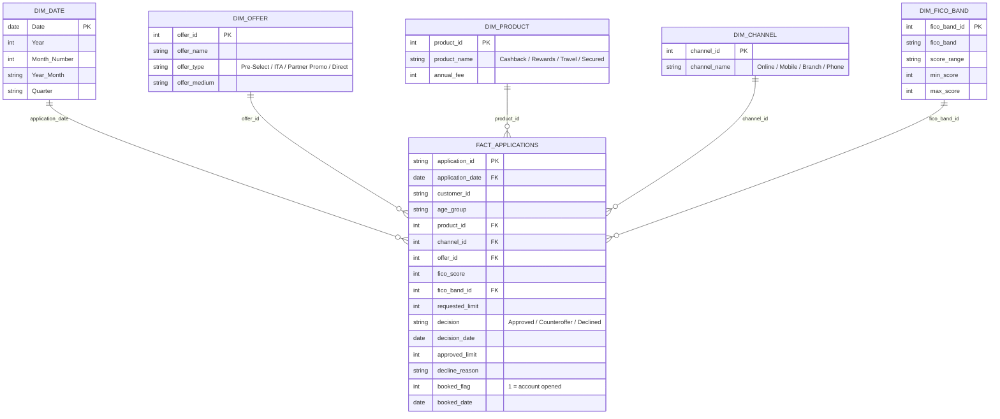

# Data Model

A simple **star schema**: one fact table of applications surrounded by small dimension tables.
Power BI uses single-direction, one-to-many relationships from each dimension to the fact table,
plus a DAX date table (`DimDate`) related on `application_date`.

## Design choices

- **Grain:** one row per application keeps every KPI additive and easy to slice.
- **Decision and booking on the same row:** the funnel (submitted → approved → booked) can be
  built with simple measures, no extra joins.
- **Dimensions are tiny and descriptive:** report filters show business-friendly names.
- **Date table in DAX:** enables month-over-month, year-over-year and rolling averages.
